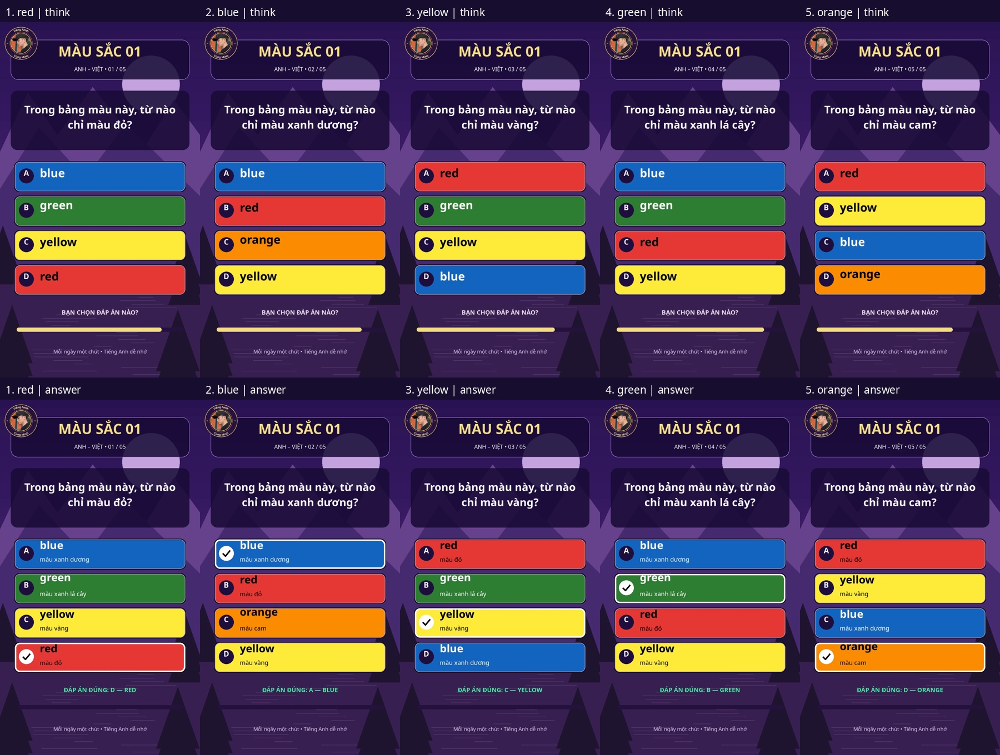

# Màu sắc — 20 từ, 4 video có giọng Việt–Anh

**Đã hoàn tất giọng ElevenLabs sau khi cập nhật khóa ngày 19/11/2026.** Cùng giọng đã chọn đọc đầy đủ câu hỏi tiếng Việt và từ đáp án tiếng Anh.

[Tải cả 4 video CÓ LỜI — ZIP](https://github.com/adminminhdz95/bep-cua-minh-tools/raw/refs/heads/main/vocab-video/published/mau-sac/4-video-mau-sac-co-loi.zip) · [20 từ và bảng màu](20-tu-mau-sac.md)

Video 1080×1920/30fps, có logo. Mỗi video 5 câu; lời Việt ở tốc độ 92%, sau đó ít nhất 4 giây đếm ngược. Tiếng Anh phát sau âm báo đáp án. Thời lượng tăng để không cắt lời. Từng lựa chọn mang đúng màu của từ tiếng Anh và giữ màu khi hiện đáp án; dấu ✓, viền trắng và tên đáp án chỉ lựa chọn đúng.

| Video | Từ vựng | Thời lượng | MP4 có lời |
|---:|---|---:|---|
| 1 | red, blue, yellow, green, orange | 45.33s | [Tải](https://github.com/adminminhdz95/bep-cua-minh-tools/raw/refs/heads/main/vocab-video/published/mau-sac/01-mau-sac-phan-1-co-loi.mp4) |
| 2 | purple, pink, brown, black, white | 44.50s | [Tải](https://github.com/adminminhdz95/bep-cua-minh-tools/raw/refs/heads/main/vocab-video/published/mau-sac/02-mau-sac-phan-2-co-loi.mp4) |
| 3 | gray, beige, navy, maroon, olive | 47.17s | [Tải](https://github.com/adminminhdz95/bep-cua-minh-tools/raw/refs/heads/main/vocab-video/published/mau-sac/03-mau-sac-phan-3-co-loi.mp4) |
| 4 | turquoise, cyan, magenta, gold, silver | 48.83s | [Tải](https://github.com/adminminhdz95/bep-cua-minh-tools/raw/refs/heads/main/vocab-video/published/mau-sac/04-mau-sac-phan-4-co-loi.mp4) |



## Kiểm tra

Cả 4 MP4 đã giải mã toàn bộ và kiểm tra màu sau nén, dấu đáp án, thanh thời gian, giọng đọc, âm báo, mức âm. Đã xem contact sheet và khung hình toàn kích thước của từng video, cùng biểu đồ tín hiệu âm thanh. Không tuyên bố đã nghe trực tiếp.

Nhận dạng khớp 20/20 đáp án Anh và 17/20 câu hỏi Việt. Các khác biệt Việt còn lại bên dưới chưa được xác nhận bằng nghe trực tiếp. ASR không chứng nhận phát âm chuẩn tuyệt đối. [Báo cáo](validation.json).

- Video 2, câu 2: dự kiến **Trong bảng màu này, từ nào chỉ màu hồng?**; nhận dạng **Trong bảng màu này, từ nào chỉ màu hông?**.
- Video 3, câu 4: dự kiến **Trong bảng màu này, từ nào chỉ màu đỏ nâu sẫm?**; nhận dạng **Trong bảng màu này, từ nào chỉ màu đỏ nâu sấm?**.
- Video 4, câu 1: dự kiến **Trong bảng màu này, từ nào chỉ màu xanh ngọc lam?**; nhận dạng **Trong bảng màu này, từ nào chỉ màu xanh ngọc lám?**.

## Dựng lại

```bash
vocab-video/.venv/bin/python vocab-video/published/mau-sac/render_with_voice.py
```

Cần khóa và Voice ID đã cấu hình; nội dung gửi tới ElevenLabs có thể tính phí theo tài khoản. Script dùng cache, tính thời lượng theo audio, không cắt lời và tự kiểm tra MP4.

[Bộ xem trước cũ KHÔNG LỜI](4-video-mau-sac-khong-loi.zip) được giữ riêng. Bản ZIP này được tạo trước khi cập nhật khóa và chứa ghi chú lỗi 401 lịch sử.

Vàng kim và bạc là màu phẳng đại diện trên màn hình, không mô phỏng phản chiếu kim loại.
